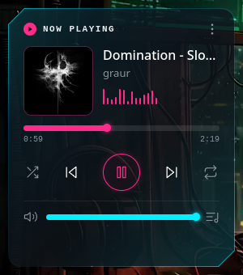

# Music Player Widget

A cyberpunk "Now Playing" desktop widget for Linux that shows and controls what's playing in **YouTube Music** (in Brave). It sits on the desktop below your windows.



  

## Features

- Title, artist and cover art for the current track
- Play/pause, next, previous
- Progress bar that matches YouTube Music to the second; click it to seek
- **Real shuffle and repeat** (off / all / one): the buttons press YouTube Music's own controls and light up to match
- Volume slider and mute (controls Brave's actual audio stream)
- Drag it anywhere, including onto another monitor; lock its position, pick a background color
- Works on X11 and Wayland (KDE Plasma tested)

## How it works

Most of the widget runs on MPRIS (the standard Linux media-control interface) via `playerctl`. That isn't enough for YouTube Music: it plays the whole queue as one continuous stream, so the time MPRIS reports keeps counting across songs, and MPRIS has no shuffle at all.

So an optional small browser extension reads YouTube Music's own player bar (per-track time, shuffle, repeat, cover art) and clicks its real buttons. It talks to the widget through a native messaging host:

```
YouTube Music tab → extension → native/host.py → unix socket → widget
```

The extension only has access to `music.youtube.com`. Without it the widget still works, but shuffle/repeat do nothing and the progress bar will be off for YouTube Music.

## Requirements

- Linux (X11 or Wayland)
- Python 3.10+
- PyQt6 + PyQt6-WebEngine
- `playerctl` and `pactl` (PipeWire or PulseAudio)
- Brave with [Plasma Browser Integration](https://chromewebstore.google.com/detail/plasma-integration/cimiefiiaegbelhefglklhhakcgmhkai) (for play/pause/next on MPRIS)
- layer-shell-qt (Wayland placement; without it the compositor decides where the widget goes)

## Installation

```bash
git clone https://github.com/jolinarn/music-player-widget.git
cd music-player-widget
```

Install the dependencies:

```bash
# Arch / CachyOS
sudo pacman -S python-pyqt6 python-pyqt6-webengine playerctl layer-shell-qt
```

### YouTube Music bridge (recommended)

1. Register the native host with Brave:
   ```bash
   ./native/install.sh
   ```
2. In Brave open `brave://extensions`, turn on **Developer mode**, click **Load unpacked** and pick the `extension/` folder.
3. Reload your YouTube Music tab (F5).

If you move the repo folder, run `install.sh` again.

## Usage

```bash
cd ~/music-player-widget
python3 player.py
```

Only one copy runs at a time. Launching it again just exits.

### Autostart (KDE / GNOME)

Create `~/.config/autostart/music-player-widget.desktop`:

```ini
[Desktop Entry]
Type=Application
Name=Music Player Widget
Exec=bash -c "cd ~/music-player-widget && python3 player.py"
Icon=audio-x-generic
X-GNOME-Autostart-enabled=true
```

## Configuration

At the top of `player.py`:

| Setting | Default | What it does |
|---|---|---|
| `PLAYERS` | `plasma-browser-integration,brave` | MPRIS players to follow, in priority order |
| `WAYLAND_START_POS` | `(40, 40)` | Where the widget appears on Wayland |

Background color and position lock are in the widget's **⋮** menu. The widget remembers where you dragged it, including which monitor (`~/.config/music-player-widget/position.json`).

## Troubleshooting

- **Stuck on "Nothing Playing"**: check `playerctl -l` lists a Brave player while music plays.
- **Shuffle/repeat do nothing**: the bridge isn't connected. In YouTube Music press Ctrl+Shift+J and open the **top ▾** context dropdown. *Music Player Widget Bridge* should be listed. If it isn't, reload the tab. Host log: `~/.local/state/music-player-widget/host.log`.
- **After updating the extension files**: click reload on it in `brave://extensions` **and** reload the YouTube Music tab.
- **Wayland dragging**: you drag a dashed outline, and the widget jumps there when you let go (layer-shell windows can't be moved live smoothly). The outline can cross onto another monitor.

## License

MIT
